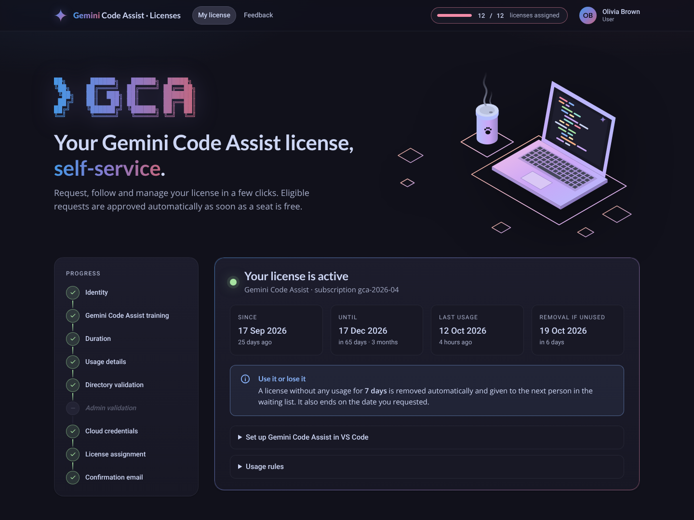

# Gemini Code Assist — License Portal

Self-service portal to request, assign, monitor and reclaim **Gemini Code Assist Standard / Enterprise** licenses in a Google Cloud organization.



- Automatic assignment when the user is eligible (training + enterprise directory GPS code) and a seat is free
- Admin escalation, approval / rejection with history, manual assignment, atomic transfer, criteria-based mass removal
- Waiting list when the pool is exhausted, priority buffer when Google or the directory time out (retried every 7 min)
- Automatic removal of licenses unused for 7 days or expired
- Subscription renewal detection with license migration (every 3 h + manual refresh for super admins)
- Deviation tracking against Google (source of truth), KPIs and technical observability

**Stack**: Go 1.26 · Cloud Run (web + worker) · Identity-Aware Proxy · Cloud SQL for PostgreSQL 16 · Cloud Scheduler · Secret Manager · Cloud Commerce Consumer Procurement API · Cloud Identity Groups API.

## Quick start (local, everything simulated)

```bash
docker compose up --build        # http://localhost:8080 — fake Google API, simulated directory, demo data
```

Without Docker for the app itself (PostgreSQL still needed):

```bash
make db      # PostgreSQL in docker compose
make run     # go run with DEMO_SEED=true
```

A yellow **DEV** bar lets you switch identity (super admin, admin, user in every state).

## Tests

```bash
make test        # unit tests
make db test-int # unit + integration tests against PostgreSQL (race detector on)
```

## Documentation

The full documentation lives in the **[project wiki](../../wiki)**: architecture and decisions, functional specification, request lifecycle, Google APIs and permissions, data model, KPIs, security, configuration, deployment, runbook.

Wiki pages are versioned in [`docs/wiki/`](docs/wiki) and published to the GitHub wiki by the `Publish wiki` workflow.

Design language and its changelog: [`DESIGN.md`](DESIGN.md).

## Repository layout

```
cmd/gcalm            portal binary (APP_MODE=web | worker | all)
cmd/edsim            enterprise directory simulator (HTTP)
config/              roles.yaml (admins, in git) · policy.yaml (business rules)
internal/            domain · service · store · gcp · directory · web · jobs · …
deploy/terraform     Google Cloud infrastructure
docs/wiki            wiki sources
```
