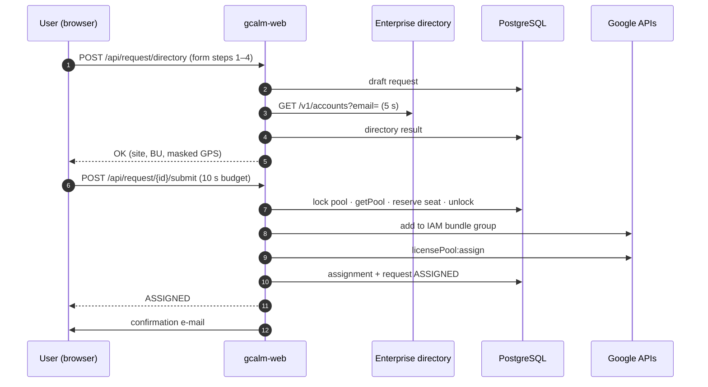

# Architecture

## Overview

```
                    Google SSO
  Browser ───────▶ Identity-Aware Proxy ───▶ Cloud Run "gcalm-web"  (APP_MODE=web)
                                                 │  html/template pages + JSON API
                                                 │
  Cloud Scheduler ──Run API──▶ Cloud Run jobs "gcalm-<name>"  (gcalm job <name>)
     buffer-retry  */7 min                       │  one execution per run, retried once
     queue         */7 min                       │
     subscription-refresh  every 3 h             │
     purge         hourly                        │
     directory-recheck  nightly                  │
     housekeeping  daily                         │
                                                 ▼
                         ┌──────────── same Go binary, same image ────────────┐
                         │ service layer (business rules)                       │
                         │   ├─ store ──────────▶ Cloud SQL PostgreSQL 16       │
                         │   ├─ gcp.Licensing ──▶ Cloud Commerce Consumer       │
                         │   │                     Procurement API (orders,     │
                         │   │                     license pool)                │
                         │   ├─ gcp.Credentials ▶ Cloud Identity Groups API     │
                         │   │                     (IAM bundle group)           │
                         │   ├─ directory ──────▶ Enterprise directory (HTTP)   │
                         │   ├─ mail ───────────▶ Workspace SMTP relay          │
                         │   └─ tracker ────────▶ Jira / GitLab                 │
                         └──────────────────────────────────────────────────────┘
                         Secrets: Secret Manager → env vars · Logs: Cloud Logging (JSON)
```

## Google Cloud services

| Need | Service | Why |
|---|---|---|
| Run the portal | **Cloud Run** service `gcalm-web` + **Cloud Run jobs** `gcalm-*` (1 image) | Serverless, scales to zero, no cluster to operate. The service is user-facing; each scheduled task is a job execution with no HTTP endpoint at all. |
| Google SSO | **Identity-Aware Proxy** on Cloud Run | SSO with the Workspace account without writing any OAuth code; signed JWT verified by the app. |
| State | **Cloud SQL for PostgreSQL 16** | Relational data (queue positions, history, daily KPIs) and transactional guarantees (one open request per user, one active license per user). Tiny volume → 1 vCPU instance. |
| Scheduled tasks | **Cloud Scheduler** → Cloud Run jobs | Managed cron executing the jobs through the Cloud Run Admin API (OAuth token of a dedicated service account); Cloud Run retries a failed execution; each run is also recorded in the `job_runs` table. |
| Delivery | **GitLab CI/CD** + **Workload Identity Federation** | Keyless: GitLab OIDC token exchanged for a short-lived token of a deployer service account limited to image push and rollout ([[Continuous Integration]]). |
| Secrets | **Secret Manager** | DB URL, directory API key, tracker token, SMTP password injected as env vars by Cloud Run. |
| Licenses | **Cloud Commerce Consumer Procurement API** | Official API behind the console "Manage licenses" page. |
| Credentials | **Cloud Identity Groups API** | Adds / removes the user in the group that carries the Gemini IAM roles. |
| Logs, alerts | **Cloud Logging / Monitoring** | JSON logs (`severity`, `message`), log-based metrics and alert policies (Terraform). |

Firestore was considered and rejected: queue positions, per-day KPIs and inventory filters are naturally SQL; the dataset is small; Cloud SQL costs ~30 €/month at this size.

## Code layout

| Package | Responsibility |
|---|---|
| `cmd/gcalm` | Wiring, modes (`web`, `worker`, `all`), graceful shutdown, Cloud Logging JSON handler |
| `internal/domain` | Statuses, end reasons, steps, durations — no dependency |
| `internal/service` | **All business rules** (request flow, fulfilment, queue, buffer, admin, purge, subscription refresh, reconciliation, KPIs, demo seed) |
| `internal/store` | PostgreSQL queries (pgx), embedded migrations, advisory locks |
| `internal/gcp` | Procurement API client (official Go client, REST transport), Cloud Identity group credentials, fakes |
| `internal/directory` | Enterprise directory HTTP client + deterministic simulator |
| `internal/telemetry` | Timing / classification of every outbound call → `api_calls` table + logs |
| `internal/jobs` | Job runner (advisory lock per job, `job_runs`), Cloud Scheduler endpoint |
| `internal/web` | Routes, middlewares (IAP auth, rate limit, CSRF, CSP), templates, static assets |
| `internal/mail`, `internal/tracker` | E-mails (SMTP / log), feedback forwarding (Jira / GitLab / log) |

No front-end build chain: server-rendered `html/template`, vanilla JavaScript, Chart.js vendored. Everything is embedded in the binary.

## Concurrency model

- **Seat consumption** is the only critical section: `pg_advisory_lock(pool)` held for *a few milliseconds* to read the Google counter, subtract the seats reserved by in-flight / buffered requests, and write a reservation on the request. All slow calls (credentials, assignment) run **outside** the lock. One hanging Google call cannot block other users (covered by `TestNoGlobalLockDuringGoogleCalls`).
- **Jobs** take their own advisory lock: no overlap even with several worker instances or a manual run.
- **Database constraints** make the invariants hold even under races: one open request per user, one active assignment per user, one waiting queue entry per user, one pending buffer entry per user, one open deviation per (user, subscription, kind).

## Request path (eligible user, seat available)


