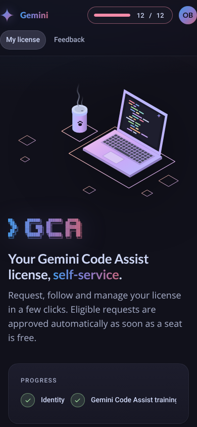

# Design language

The design language is versioned **with the code** in [`DESIGN.md`](../blob/master/DESIGN.md) at the root of the repository, together with its changelog. Any visual change updates the CSS *and* the changelog in the same pull request.

Summary:

- **Dark theme** based on the Catppuccin Mocha palette; **Gemini gradient** (`#4796E4 → #847ACE → #C3677F`) reserved for identity and the primary action.
- Typography: **Roboto** (UI), **Open Sans** (text), **Lato** (display), Roboto Mono (code).
- Google-like calm layout: negative space, 4 px grid, pill buttons and chips, 20 px card radius, glassy sticky top bar.
- Status vocabulary: 🟢 OK · 🟠 warning · 🔴 critical · 🔵 info · ⚪ idle — identical in the progress panel, badges, alerts and KPIs.
- Isometric laptop + coffee cup illustration (generated SVG) and `> GCA` gradient ASCII wordmark on the landing page.

