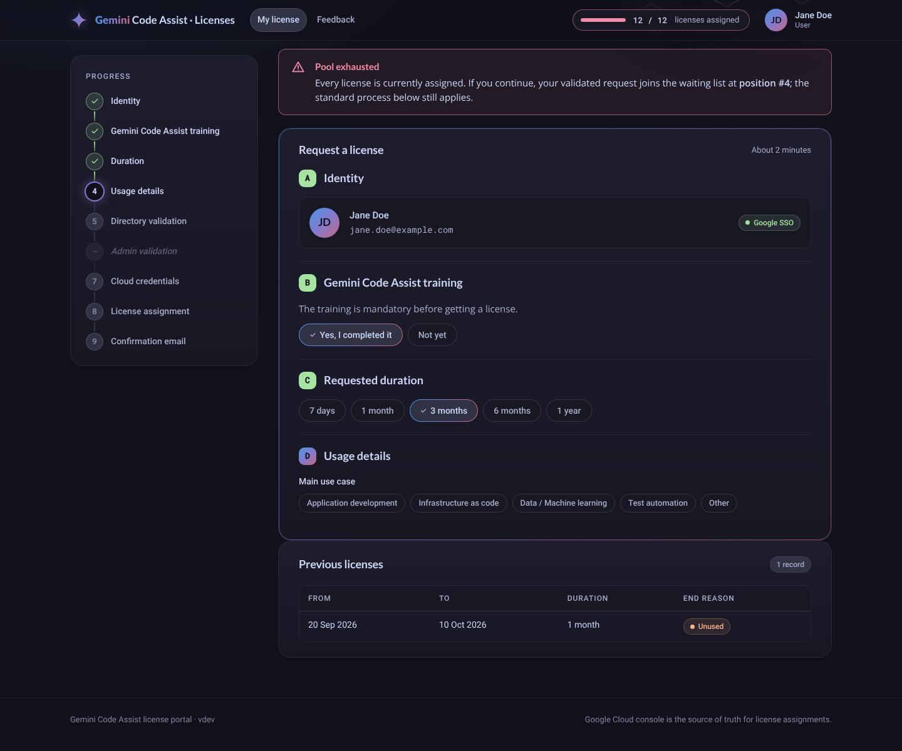
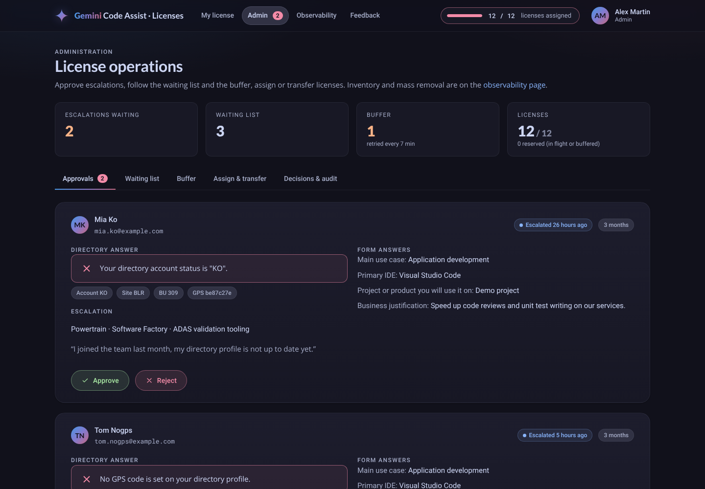

# Functional specification

UI language: **English only**. Every page shows the top bar: logo, navigation (*My license*, *Feedback*; *Admin* and *Observability* for admins), **pool counter** `assigned / total` (Google counters, visible to everyone) and the user.

## 1. Landing page

Layout: **left panel = progress** (steps A → Z), **centre = subscription**. The user is identified by Google SSO (IAP).

### Progress steps

| # | Step | Turns green when | Other states |
|---|---|---|---|
| A | Identity | "This is me" clicked (e-mail from SSO) | — |
| B | Gemini Code Assist training | "Yes, I completed it" | 🔴 "Not yet" → link to the training, process blocked |
| C | Duration | 7 days · 1 month · 3 months · 6 months · 1 year | — |
| D | Usage details | every question valid (questions from `policy.yaml`, each answer unlocks the next) | — |
| W | Directory validation | account OK + eligible GPS code | 🔴 functional KO · 🟠 directory timeout (buffer) |
| W1 | Admin validation | approved | ⚪ grey when not needed · 🔵 waiting · 🔴 rejected |
| X | Cloud credentials | IAM bundle granted | 🟠 timeout → buffer |
| Y | License assignment | license assigned in Google | 🔵 waiting list · 🟠 timeout → buffer |
| Z | Confirmation e-mail | e-mail sent | 🟠 will be retried |

### States of the centre frame

| State | Shown when | Content |
|---|---|---|
| 🟢 **Active** | Google lists the user in the pool | Since · Until (+ relative) · Last usage · Removal date if unused · reminder of the 7-day rule · VS Code set-up · usage rules (CLI forbidden). All steps green. |
| 🟠 **Buffer** | a pending buffer entry exists | Date of buffering, pending step, retries, **position x / n**, mention *priority assignment*, "come back in ~10 minutes". The failing step is orange on the left. |
| 🔵 **Case 0.1 — pending admin** | escalated request waiting | State, **greyed read-only form** with the previous answers, records counter (*n requests · m rejected*), list of admins (not super admins), previous rejections if any. |
| 🔴 **Case 0.2 — rejected** | last request rejected | Rejections counter, table of rejected requests (10 per page): request date, escalation input, rejection date / admin, reason. Button *"I think this is not legitimate — submit a new request"* reopens the form (pre-filled). |
| 🔵 **Case 1 — waiting list** | request validated, pool exhausted | "Pool exhausted", request date, queue date, **position #x of n**, *Leave the waiting list*. |
| 🔴 **Directory KO** | directory KO after a buffered retry | Reason + *Escalate* / *Withdraw*. |
| **Case 2 — new** | none of the above | If no seat (Google available − reservations ≤ 0): **red box on faded red background** "Pool exhausted — you will join the waiting list at position #X", then the standard process. |

When the user has no active license, a **Previous licenses** table shows each former license (from, to, duration, end reason: *Unused*, *Expired*, *Admin removal*, *Removed outside the portal*, *Subscription ended*).

### Standard process

1. A → D in the browser (no server call). Server-side validation is repeated on submission.
2. **W** — `POST /api/request/directory`: the request is stored as a draft and the directory is called (5 s).
   - ✅ OK → site, business unit, masked GPS code; the answers are frozen.
   - 🔴 functional KO (account KO, no / invalid / non-eligible GPS code, unknown account) → *Withdraw* or *Escalate*. Escalation (**W1**) asks for division, entity, project and an optional comment, then lists the admins to contact.
   - 🟠 technical KO (timeout, 5xx, network) → buffer.
3. **X Y Z** — `POST /api/request/{id}/submit` with a loading animation; **10 s budget**:
   - seat available → credentials, license, e-mail → 🟢 *Your license is active*;
   - pool exhausted → 🔵 *You are #x in the waiting list* (+ e-mail);
   - Google too slow → 🟠 buffer, *come back in ~10 minutes* (the seat stays reserved).

### Confirmation e-mail (Z)
Request date, assignment date, planned end · how to set up Gemini Code Assist in VS Code (extension, sign-in, project) · **command-line usage forbidden (Gemini CLI or any terminal / agent tool)** · link to the company AI usage training · reminder of the 7-day rule.

## 2. Automatic rules

| Rule | Detail |
|---|---|
| Auto-approval | Training ✓ + directory account status `OK` + GPS code matching `policy.eligibility` (format, optional allow-lists of GPS codes / business units) |
| Unused license | No usage for `unused_days` (7) → removed (*Unused*). Last activity = latest of assignment, subscription migration, last usage stored, Google `recentUsageTime` (refreshed by Google within 24 h). |
| Expiry | Requested duration elapsed → removed (*Expired*). |
| Queue | Served by priority (subscription rollover 10 > buffer 5 > normal 0) then FIFO, as soon as a seat is released (event) and every 7 min (job). |
| Buffer | Retried every 7 min, before the queue; abandoned after 30 attempts (request FAILED, visible to admins). |
| Subscription | Refreshed every 3 h (+ button for super admins). If the current subscription becomes inactive and a new active one exists, licenses are migrated (oldest first); users not fitting in the new pool go first in the queue. |

## 3. Administration (admins and super admins)

| Tab | Actions |
|---|---|
| Approvals | Directory answer, escalation details, form answers → **Approve** (assign or queue) / **Reject** (reason mandatory, kept in the user's history, e-mail sent) |
| Waiting list | Position, waiting since, priority → remove a user |
| Buffer | Stage, attempts, last error → **Retry now**; abandoned entries |
| Assign & transfer | Assign a license to an e-mail (source admin) · **Transfer** a license from A to B atomically (A ends with *Admin removal*) |
| Decisions & audit | Last decisions and the audit log of every admin / system action |

## 4. Observability (admins)

See [[KPIs and Observability]]. Includes the **inventory** of assigned licenses: filter chips (site, business unit, source, unused ≥ 7/14/30 days, expiring within 7/30 days), e-mail search, selection, **Remove selected** and **Remove all matching** (mass removal by criteria, refused if the matching count changed since the preview).

Super admins additionally get: **Force subscription refresh**, **Run now** on each job, and (fake mode only) the simulation panel.

## 5. Feedback

Every user can send an improvement idea, a problem or a question. It becomes a Jira (or GitLab) work item created by a technical account; the SSO e-mail of the requester is attached automatically.

## 6. Roles

| Role | Source | Rights |
|---|---|---|
| User | anyone allowed through IAP | own license, feedback |
| Admin | `config/roles.yaml` → `admins` | + admin page, observability, inventory, deviations |
| Super admin | `config/roles.yaml` → `super_admins` | + force refresh, run jobs, simulation (dev) |
