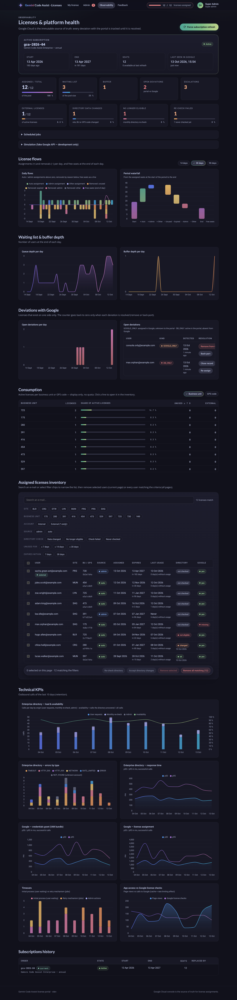

# KPIs and observability

Page *Observability* (admins). Data from `/api/obs/*`, charts with Chart.js. Everything is embedded in the portal: no BigQuery / Looker Studio layer (decision #25 in [[Open Questions]]).

## Business KPIs

| KPI | Definition |
|---|---|
| Active subscription | order ID, display name, start, end (+ auto-renewal), seats, last seen in Google |
| Assigned / total | Google counters (`totalLicenseCount − availableLicenseCount` / `totalLicenseCount`) — also in the top bar for everyone |
| **Daily flows** (diverging bars) | per day: + auto assignments, + admin assignments, + other (back-port) / − unused, − expired, − admin removals, − other; dashed line = **free seats** at the end of the day |
| **Period waterfall** | start (assigned seats at the beginning of the period) → each + / − category → end → **free seat gap** up to the pool size |
| Queue depth per day | users waiting at the end of each day |
| Buffer depth per day | pending buffer entries at the end of each day |
| **Deviations per day** | open deviations at the end of each day. Back to 0 only when every deviation is resolved: *Remove from Google* / *Back-port* (GOOGLE_ONLY), *Close record* / *Re-assign* (DB_ONLY), or self-healed |
| **External licenses** | active licenses held by external accounts (`*.ext@`): count and **ratio of active licenses (%)** |
| Directory data changed | active licenses whose site / BU / GPS code changed since assignment (monthly re-check) |
| No longer eligible | active licenses that would not be auto-approved today |
| Re-check failed | last re-check in error (+ number never checked yet) |
| **Consumption** | active licenses per **business unit** or per **GPS code**: count, share of active licenses, unused for ≥ `unused_days`, external accounts; GPS codes outside the allowlist are flagged (admin-approved licenses). Display only, no quota. A line opens the inventory filtered on it (same counts). |
| Inventory | active licenses by pages of 200 (most recent first, *Previous / Next*), e-mail search, filter chips (incl. account type and directory check), GPS code filter (from *Consumption*), selection and removal (see [[Functional Specification]]) |

Period selector: 14 / 30 / 90 days.

## Technical KPIs (10-day retention)

| KPI | Source |
|---|---|
| **Directory load & availability** | calls per day by origin — user requests (UX), monthly re-check (JOB), admin — and availability % (answered calls / all calls): does the directory hold the load? |
| Directory errors by type (stacked bars) | `api_calls` target `DIRECTORY`: TIMEOUT, HTTP_5XX, HTTP_4XX, NETWORK, RATE_LIMITED, NOT_FOUND (unknown account) |
| Directory response time | p50 / p95 of successful lookups |
| Google credentials grant time | p50 / p95 of `GOOGLE_CREDENTIALS grant` |
| Google license assignment time | p50 / p95 of `GOOGLE_LICENSE assign` |
| Timeouts | per day, **initial process (UX — user waiting)** vs **retry mechanism (JOB)** vs admin actions |
| App access vs Google license checks | page views per day vs `getPool` / `enumerate` calls — shows the effect of the cache + rate limiting |

## Jobs
Last run, trigger, status and summary of each job; *Run now* for super admins.

## Logs and alerts (Cloud Logging / Monitoring)
- JSON logs with `severity` / `message`: one access log per request (method, path, status, duration, user), one line per outbound call failure, one line per job run.
- Log-based metrics (Terraform): `gcalm/job_errors` (label `job`), `gcalm/google_timeouts`.
- Alert policies: any job error within 15 min; more than 10 Google timeouts within 30 min.
