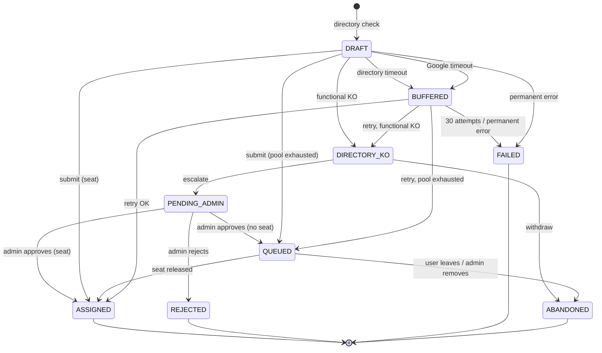

# Request lifecycle

## Request states



Open states (`DRAFT`, `DIRECTORY_KO`, `PENDING_ADMIN`, `QUEUED`, `BUFFERED`): **at most one per user** (partial unique index).

## Fulfilment pipeline

```
fulfil(request)
 1. current subscription?            no / inactive ─────────────▶ QUEUED
 2. already licensed in Google?      yes → skip 3 and the assignment (step 8)
 3. reserve a seat  ─ lock(pool) ─ getPool (4 s) ─ available − reserved > 0 ? ─ write reserved_at ─ unlock
        no seat ──────────────────────────────────────────────▶ QUEUED (reservation released)
        lock wait / getPool timeout ──────────────────────────▶ BUFFERED (no seat kept)
 4. step 7  credentials: add to IAM bundle group  timeout/5xx ────▶ BUFFERED (seat kept)
 5. step 8  licensePool:assign                    timeout/5xx ────▶ BUFFERED (seat kept)
                                                  4xx ────────────▶ FAILED
 6. persist assignment (expires_at = now + duration), close queue/buffer entries ▶ ASSIGNED
 7. step 9  confirmation e-mail (retried by the buffer job if it fails)
```

Budgets: **10 s** when a user waits (`UX_TIMEOUT`), 30 s per call in jobs (`JOB_CALL_TIMEOUT`), 5 s for the directory (`DIRECTORY_TIMEOUT`).

A timeout does not mean failure: Google may have assigned the license anyway. The retry first checks the pool snapshot and skips the assign call if the user is already licensed; the reconciliation ignores users holding a reservation so this window is never reported as a deviation.

## Seat accounting

```
available for a new request = Google availableLicenseCount
                            − requests holding a reservation (in flight or BUFFERED at CREDENTIALS / LICENSE stage)
```

- Buffered requests keep their seat → **priority over the waiting list** (the "priority assignment" promised to the user).
- A reservation older than 15 minutes on a non-buffered request is ignored (crashed process).
- Transfers reserve the seat of the target *before* removing the source license, so the queue cannot take it.

## Queue order

`priority DESC, enqueued_at, id` with priorities: 10 = lost the seat during a subscription rollover · 5 = came from the buffer · 0 = normal.

## Assignment end reasons

| Reason | Trigger |
|---|---|
| `UNUSED` | purge job — no usage for 7 days |
| `EXPIRED` | purge job — requested duration elapsed |
| `ADMIN_REMOVAL` | admin removal, mass removal, transfer (source) |
| `EXTERNAL_REMOVAL` | DB_ONLY deviation closed (license removed outside the portal) |
| `SUBSCRIPTION_ENDED` | rollover — no seat in the new pool (user re-queued with priority 10) |
